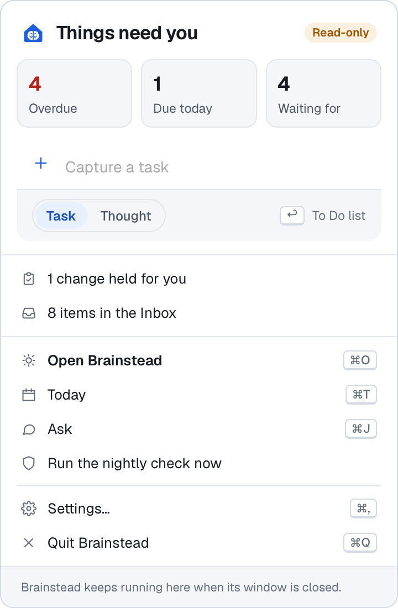
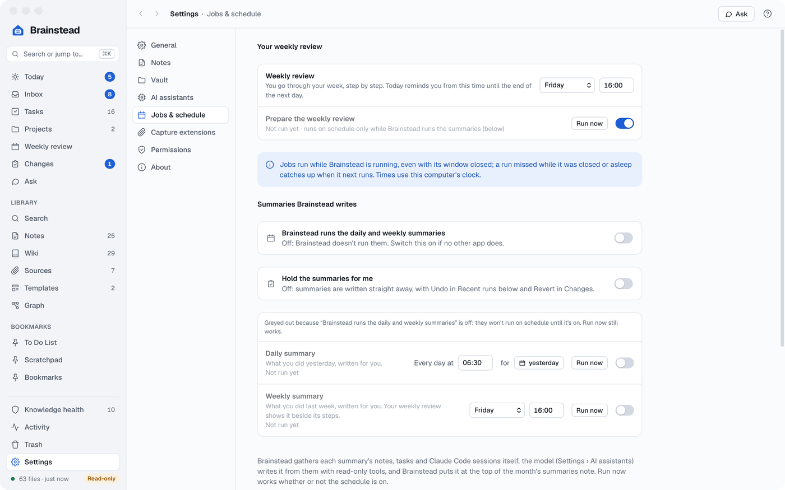
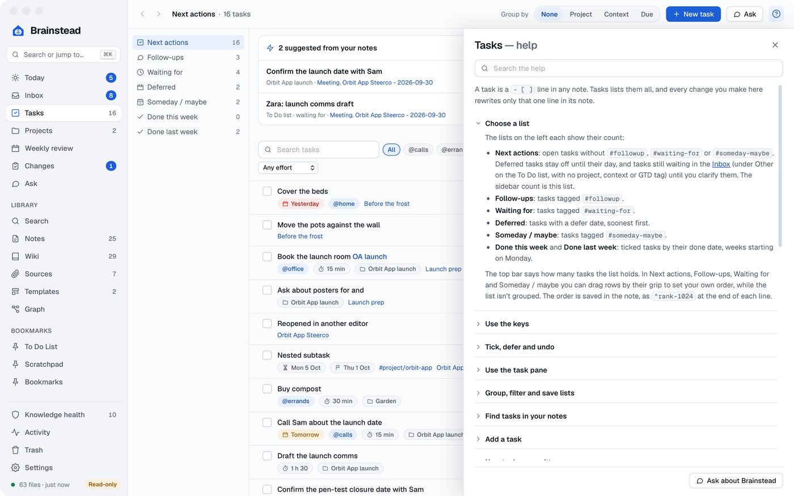
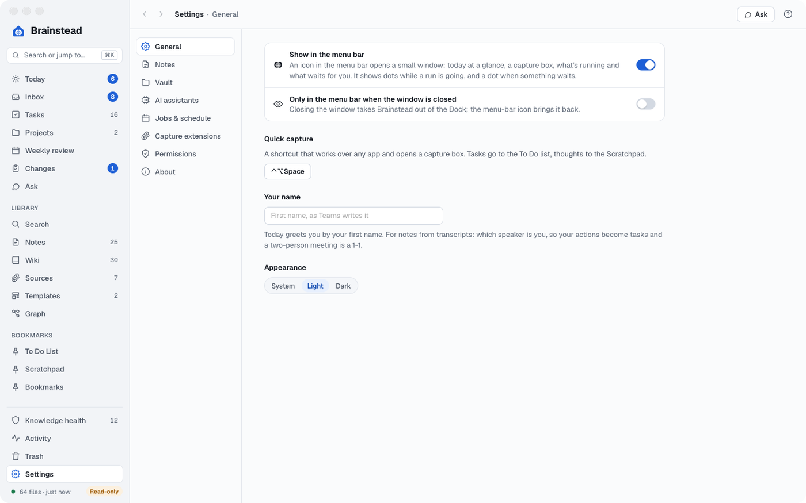

# Day to day

Brainstead keeps working while its window is closed: Quick capture, captures from the browser, the daily and weekly summaries and the daily check all run from the menu bar (the system tray, bottom right, on Windows).

[The menu bar](#the-menu-bar) · [Summaries and jobs](#summaries-and-jobs) · [Help](#help) · [Settings](#settings) · [In the background](#in-the-background)

## The menu bar

On Windows this is a system tray icon, usually under the ^ arrow at the bottom right of the taskbar. Everything below applies to it too.

<a href="images/index.md#day-to-day"><picture><source media="(prefers-color-scheme: dark)" srcset="images/tray-dark.png"></picture></a>

Brainstead's menu-bar icon shows three dots while a run is going, and a dot when something waits for you: an overdue task, changes held for you, or items in the Inbox. Click it for:

- A headline: **All clear**, **Things need you**, runs going, or what couldn't load. A **Read-only** pill shows while the vault is read-only and opens Settings › Vault. **Overdue**, **Due today** and **Waiting for** counts open Today.
- A capture box, the same as Quick capture.
- Each run that's going (an ingest, a summary, the daily check, Find tasks and projects and so on), with its progress and **Stop**.
- Changes held for you and items in the Inbox, each opening its screen.
- **Open Brainstead** (⌘O), **Today** (⌘T), **Ask** (⌘J), **Run the daily check now**, **Settings…** (⌘,) and **Quit Brainstead** (⌘Q).

Turn on **Open at login** (in Settings › General or the menu-bar window) and **Only in the menu bar when the window is closed** (Settings › General), and Brainstead starts when you log in and stays out of the Dock until you open its window. Windows has no such setting, because a closed window is already out of the taskbar: with **Show in the menu bar** on, closing the window hides it to the tray; with it off, closing the window quits Brainstead. On Windows, **Open at login** starts Brainstead with its window, and starting Brainstead a second time brings the running window forward.

## Summaries and jobs

<a href="images/index.md#day-to-day"><picture><source media="(prefers-color-scheme: dark)" srcset="images/settings-jobs-dark.png"></picture></a>

In Settings › Jobs & schedule:

- **Daily summary** and **Weekly summary**: a model writes a summary of the day's or week's notes, tasks and Claude Code sessions. A note with a day in its name, such as a meeting note, counts on that day, however late it was written. **Run now** can redo a past day (pick it in **for**). The summary goes at the top of the month's summaries note, undoable, or waits in Changes if **Hold the summaries for me** is on. Each runs as a chat in Ask, in a tab marked with a calendar. (The weekly summary isn't the Weekly review, which you do yourself.)
- **Prepare the weekly review**: 4 hours before the review, a model reads the week and suggests actions for each step of the [weekly review](tasks.md). Nothing changes until you accept one. It has its own switch, **Run now** and **Stop**, and runs on schedule only while Brainstead runs the summaries.
- To use these, turn on **Brainstead runs the daily and weekly summaries**, and switch them off in any other app that writes them.
- **Daily check**: looks for contradictions in wiki pages that changed, updates the list of pages in `index.md`, and counts pages edited out of shape (for Knowledge health's Reshape pages). It can also re-ingest sources that changed (a switch under Ingest in Settings › AI assistants).
- **Recent runs**, with **Open**, **Show** and **Undo**; the Daily, Weekly and Daily check rows have **Stop** while one runs.

The summaries split what you did into **Work done** and **Personal** by your projects' areas: a project in the area Personal is personal, any other is work, done projects included. A Claude Code session whose folder is named after a project counts for it (`orbit-app` is Orbit App).

A run missed while the computer slept catches up when Brainstead next runs.

To keep sessions started by your own tools (a script, another app) out of the daily summary, list them under **Your tools that start Claude Code sessions** in Settings › Jobs & schedule. Each has a name, and the folder its sessions run in, the words their first message starts with, or both. Their sessions then count as automated, not as your work. **Add a tool** adds one by hand; folders whose sessions look like a tool's are offered in one click. Assistants can list, add and remove them too.

The ingest switches (ingest new sources as they arrive, refresh pages whose sources changed) are under **Ingest** in Settings › AI assistants.

## Help

<a href="images/index.md#day-to-day"><picture><source media="(prefers-color-scheme: dark)" srcset="images/help-dark.png"></picture></a>

On Windows, ⌘ is Ctrl, ⌥ is Alt and ⇧ is Shift. Press `?` on any screen, click **?** on the top bar, or choose Help › Brainstead Help (⇧⌘?) for that screen's help in a drawer. Type to search every topic. The arrows beside the title go back and forward through the help pages you've opened since the drawer opened. Under the search box:

- **Getting started** lists the step-by-step guides, each with its number of steps or a Done mark: Start here, Capture and write, Build the wiki, Find, GTD, Knowledge health, Ask your vault, Templates and note looks, Meeting notes, Draft a reply, Compare and Doc check, Bookmarks and triage, Changes, undo and Trash, Assistants and the MCP server, Scheduled jobs and The menu bar and capture extensions. Brainstead offers them when it opens, until you tick **Don't ask me again** or turn off **Offer Getting started when Brainstead opens** in Settings › General.
- **All topics** picks any screen's or pane's help; type to find one. **Keyboard shortcuts** is one of them, and opens on the keys for the screen you're on.
- **Ask about Brainstead** puts a question to Ask, which [answers from the same help](ask.md#questions-about-brainstead).
- The keyboard shortcuts are in Help › Keyboard Shortcuts and in ⌘K.
- Help › Brainstead Website opens [the website](https://brainstead.davies.co.za/), as does the link in Brainstead › About Brainstead and the **Website** button in Settings › About.

## Settings

<a href="images/index.md#day-to-day"><picture><source media="(prefers-color-scheme: dark)" srcset="images/settings-general-dark.png"></picture></a>

Settings (⌘,) has General, Notes, Vault, AI assistants, Jobs & schedule, Capture extensions, Permissions (Mac only) and About. Press `?` on each for what's in it.

**Interface size** (General › Appearance) makes everything in the window bigger or smaller together, from 80% to 150% in steps of 10: the sidebar, lists, buttons, dialogs and the text of notes. ⇧⌘= and ⇧⌘- (Ctrl+Shift+= and Ctrl+Shift+- on Windows) change it from anywhere, ⇧⌘0 puts it back to 100%, and the View menu has the three on a Mac. It's kept per computer, not in the vault. A note's **Text size** (⌘= ⌘- ⌘0, on the note's ⋯ menu) is separate and comes on top: 120% with 18 px text shows a 21.6 px body.

## In the background

- **Updates.** Brainstead checks for a new version 20 seconds after it opens and then once a day, and offers it in its window the next time the window has the focus, with what's new in it: **Install and Restart**, **Later** (asked again at the next day's check) or **Skip This Version**. Brainstead › Check for Updates… checks now. Installing shows the download's progress, then restarts. An update waits while something is running (Ask answering, an ingest, a summary, the daily check), and restarting asks about unsaved edits first, as quitting does. On Windows, which has no menu bar, it's **Check for Updates…** in Settings › About, and the installer shows its progress, closes Brainstead and opens the new version; the Windows update reaches each release a few minutes after the Mac's.
- **The index.** Brainstead indexes the vault in a database outside it, so search and lists are instant. It picks up changes from other apps as they happen.
- **Safe writes.** Every save is all-or-nothing, keeps the file's line endings, and refuses if the file changed since it was read. Files that aren't UTF-8 open read-only.
- **Drafts.** Unsaved text is kept as a draft a second after you stop typing, and offered back after a crash.
- **Undo.** ⌘Z undoes the app's last five changes (a tick, a date, a clarified item, an assistant's change, a rename), even after a restart. In a note, ⌘Z undoes your typing.
- **`log.md` and Activity.** Brainstead records what it changes in the vault's `log.md`. **Activity** shows it with a heatmap of files changed by day, charts of your notes by type and tag, and the most linked notes.
- **The vault is yours.** Brainstead keeps only what you'd expect in the vault: notes, tasks, chats, the wiki and `log.md`. Settings, the index, drafts, name corrections and kept Doc check and Compare results live in `~/Library/Application Support/Brainstead/`.
