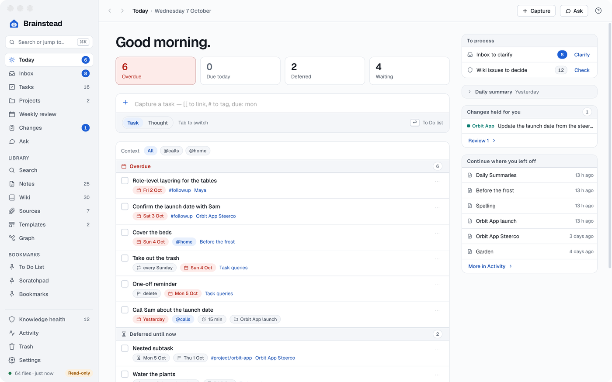
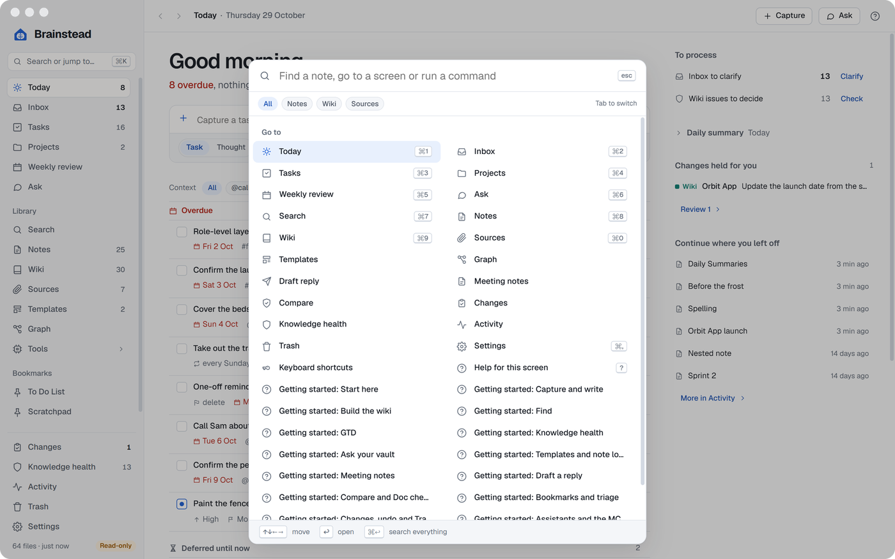

# Features

The user guide to Brainstead, a Mac and Windows app for tasks, notes and an [LLM wiki](https://gist.github.com/karpathy/442a6bf555914893e9891c11519de94f) over one folder of plain markdown files: your vault. Each screen's help (`?`) goes deeper.

<a href="images/index.md#features"><picture><source media="(prefers-color-scheme: dark)" srcset="images/today-dark.png"></picture></a>

| Page | What's in it |
|---|---|
| [Tasks and GTD](tasks.md) | Today, Quick capture, the Inbox, Tasks, Projects, the weekly review, and how tasks are written |
| [Notes](notes.md) | View, Edit and Source, saving and drafts, queries and callouts, templates, search and ⌘K, the Trash |
| [The wiki and sources](wiki.md) | Sources and the browser extensions, ingest, Changes, wiki pages, Knowledge health, contradictions, meeting notes and the other tools |
| [Ask and assistants](ask.md) | Chats with Claude Code, Codex, Copilot and Antigravity, what an assistant can do, Brainstead's tools in a terminal |
| [Day to day](day-to-day.md) | The menu bar (system tray on Windows), the daily and weekly summaries and the daily check, help, Settings, and what happens in the background |

## Requirements

- A Mac with Apple silicon (M1 or later) and macOS 14 or later, or a PC with Windows 10 or 11 (64-bit).
- For Ask and the AI features: Claude Code, Codex, GitHub Copilot's CLI or Antigravity, installed and signed in. Everything else works without them.
- For the capture extensions: Chrome, Edge, Brave, Vivaldi or Chromium.

## First run

The Welcome screen asks for two things (one on Windows, which has no Full Disk Access step):

- **Full Disk Access (Mac only).** A vault in a cloud-synced folder (OneDrive, iCloud Drive, Dropbox) needs it, or macOS asks for each protected place separately. Click **Open System Settings**, turn Brainstead on under Privacy & Security › Full Disk Access, and let macOS reopen it. You can skip this and do it later from Settings › Permissions.
- **Your vault**: the folder of markdown notes. Brainstead opens it **read-only**: nothing changes until you turn **Read-only** off in Settings › Vault.

No vault yet? **Create a new vault** asks for a name and a place, and adds a few example notes: a To Do list, a project, a meeting note, a template, wiki pages and sources. Each says it's an example you can delete, and **Start here** lists them. A new vault opens writable, as nothing in it is yours yet. Settings › Vault › **Add the example notes** puts back any that are missing.

Once the vault is open, a welcome offers **Getting started**: step-by-step guides in the help, beginning with your vault and finding your way around. **Not now** closes it until the next launch; tick **Don't ask me again**, or turn off **Offer Getting started when Brainstead opens** in Settings › General, to stop it. The guides are always in the help: press `?` and click **Getting started**.

Notifications are asked for the first time Brainstead has something to tell you.

Moving over from another notes app? When its files are in the vault, the **Moving over from another notes app** checklist at the top of Settings › General lists what's left to do:

- make the vault writable;
- run the daily and weekly summaries here;
- get captures arriving from the browser extensions;
- list your own automated sessions;
- switch off the other app's reviews, extensions and app;
- retire its skills and scripts: they move to the Trash, and the vault's `CLAUDE.md` tells agents to use Brainstead's tools, so their changes show in Changes.

## The window

<a href="images/index.md#features"><picture><source media="(prefers-color-scheme: dark)" srcset="images/palette-dark.png"></picture></a>

The sidebar, top to bottom:

- **Today**, **Inbox**, **Tasks**, **Projects**, **Weekly review** and **Ask**;
- the library: **Search**, **Notes**, **Wiki**, **Sources**, **Templates**, **Graph**, then **Tools**, a menu of **Draft reply**, **Meeting notes** and **Compare** (a spinner beside it means one is at work);
- your **Bookmarks**;
- at the foot, **Changes**, **Knowledge health**, **Activity**, **Trash**, **Settings**, and the index's line (a dot only while it's indexing, or if it failed).

Counts that need you, such as overdue tasks, the Inbox and changes held for you, are in bold.

| Keys | What they do |
|---|---|
| ⌘K | Search or jump to anything, and run commands |
| ⌘⇧F | The Search page |
| ⌃⌥Space (Ctrl+Shift+Space on Windows) | Quick capture, from any app |
| ⌘N | New note |
| ⇧⌘P | Read the open note aloud, then play or pause |
| ⌘. | Focus mode for the open note, wiki page or source; Esc leaves it |
| ⌥⌘1 ⌥⌘2 ⌥⌘3 (Ctrl+Shift+1 … 3 on Windows) | View, Edit or Source for the open note |
| ⌘1 … ⌘9, ⌘0 (Ctrl+1 … 0 on Windows) | Today, Inbox, Tasks, Projects, Weekly review, Ask, Search, Notes, Wiki, Sources |
| ⌘[ ⌘] | Back, forward |
| ⌘Z | Undo the last change |
| ⌘, | Settings |
| ? | Help for this screen |

On Windows, ⌘ is Ctrl, ⌥ is Alt and ⇧ is Shift, so ⌘K is Ctrl+K. The window has no title bar, as on a Mac: its minimise, maximise and close buttons are at the top right, where Windows puts them, and the empty part of any screen's top bar drags the window (double-click it to maximise or restore). Windows has no Quick Look, so where a Mac offers it (a source Brainstead can't show, the Trash) Windows opens the file in its own app.

Every screen remembers its list, filter and selection across restarts. Back and forward go through where you've been. Closing the window leaves Brainstead running in the [menu bar](day-to-day.md#the-menu-bar) (on Windows, if **Show in the menu bar** is on; otherwise closing the window quits). ⌘Q quits (on Windows, which has no menu bar, the tray's **Quit Brainstead**), asking first about unsaved edits.

## Licence and credits

Brainstead is free software under the GNU General Public License, version 3 or later.

- You may use it, share it and change it.
- Anything you pass on, changed or not, must stay free under the same licence, with its source.
- It comes with no warranty.
- The licence is in `LICENSE` in the source, and at [gnu.org](https://www.gnu.org/licenses/gpl-3.0.html).

Brainstead is built with Tauri and React, and uses CodeMirror (editor), unified with remark and rehype (markdown), KaTeX (maths), Mermaid (diagrams), pdf.js (PDFs), d3-force (graph), rrule (recurring tasks), moment, Luxon and chrono-node (dates), SQLite with FTS5 through rusqlite (the index) and `similar` (diffs). These are under the MIT, Apache 2.0, BSD or ISC licences. The type is Geist and Geist Mono, under the SIL Open Font License.
